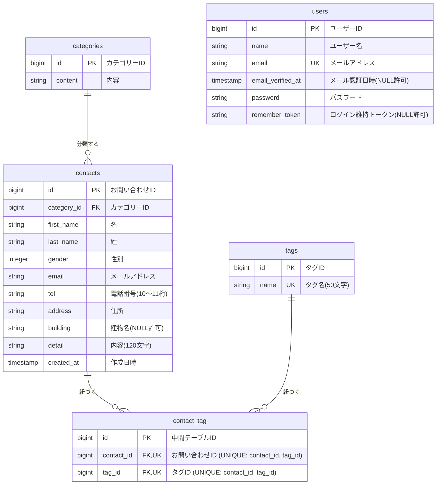

# COACHTECH お問い合わせフォーム

## 概要

COACHTECH 「基礎学習ターム 確認テスト お問い合わせフォーム」で作成した成果物です。

- 公開されているお問い合わせフォームから、誰でもお問い合わせを送信できます。
- 管理者は、管理者専用ページにログインした上で、お問い合わせ内容の確認・管理することができます。

- 実装機能
    - お問い合わせ送信用フォーム（送信内容の確認画面あり）
    - 管理者用機能
        - 管理者新規登録・ログイン・ログアウト
        - お問い合わせ一覧表示（検索機能・ページネーション付き）
        - お問い合わせの一括データ出力（BOM付きCSV）
        - お問い合わせ詳細確認
        - お問い合わせ削除
        - お問い合わせに紐づけるタグの一覧表示
        - タグ内容編集
        - タグ削除
    - 公開API
        - お問い合わせ一覧（検索・ページネーション付き）
        - お問い合わせ詳細（カテゴリ・タグ含む）
        - お問い合わせ新規作成
        - お問い合わせ更新
        - お問い合わせ削除

## ER図



## 環境構築手順

    - Docker Desktop（またはDocker Engine）が起動していることを確認してください。
    - （Windowsの方へ）以下のコマンドは WSL（Ubuntu）のターミナルで実行してください（PowerShellでは動きません）。

- STEP1：リポジトリのクローン
    - ターミナルを開き、任意の場所にリポジトリをクローンします。

        ```
        # 任意のディレクトリに移動
        cd ~

        # リポジトリのクローンを作成
        git clone https://github.com/yuhei-kawamata/contact-form-app.git

        # 作業用フォルダへ移動
        cd contact-form-app
        ```

- STEP2: 環境変数ファイル（.env）の作成
    - .env.exampleファイルをコピーして.envファイルを作成してください。

        ```
        # .envファイルの作成
        cp .env.example .env
        ```

    - .envファイルを開き、データベース接続情報が以下と一致していることを確認します。
    - > 重要: DB_HOST は localhost や 127.0.0.1 ではなく、Dockerコンテナ名である mysql を指定します。

        ```
        # .envファイルのデータベース情報が以下に書き換える
        DB_CONNECTION=mysql
        DB_HOST=mysql
        DB_PORT=3306
        DB_DATABASE=laravel
        DB_USERNAME=sail
        DB_PASSWORD=password
        ```

- STEP3：Composer依存関係のインストール（コンテナを使用）
    - Dockerコンテナ経由でPHPの依存パッケージをインストールします。

        ```
        docker run --rm \
        -u "$(id -u):$(id -g)" \
        -v "$(pwd):/var/www/html" \
        -w /var/www/html \
        -e COMPOSER_CACHE_DIR=/tmp/composer_cache \
        laravelsail/php82-composer:latest \
        composer install
        ```

    - M1/M2/M3 Mac（Apple Silicon）をお使いの方
        - Apple Silicon搭載のMacでは、`sail up -d`実行時に以下のエラーが発生することがあります：

            ```
            no matching manifest for linux/arm64/v8
            ```

        - 解決方法: `compose.yaml`を開き、mysqlサービスに`platform: 'linux/amd64'`を追加してください。
            ```
            mysql:
            image: 'mysql/mysql-server:8.0'
            platform: 'linux/amd64'  # ← この行を追加
            ports:
            ```

- STEP4：Sailの起動とエイリアス設定
    - プロジェクトのルートディレクトリ（contact-form-app）で下記コマンドを実行してください。

        ```
        # Sailをバックグラウンドで起動（初回はイメージのダウンロードに数分かかることがあります）
        ./vendor/bin/sail up -d

        # エイリアスを設定して 'sail' だけでコマンドを実行できるようにする（任意）
        echo "alias sail='[ -f sail ] && bash sail || bash vendor/bin/sail'" >> ~/.zshrc

        # または bash の場合
        # echo "alias sail='[ -f sail ] && bash sail || bash vendor/bin/sail'" >> ~/.bashrc

        # シェルを再起動するか、新しいターミナルを開いてエイリアスを有効にする
        exec $SHELL
        ```

- STEP5：アプリケーションキーの生成
    - プロジェクトのルートディレクトリ（contact-form-app）で下記コマンドを実行してください。
        ```
        sail artisan key:generate
        ```

- STEP6: データベースのマイグレーションと初期データ投入

    ```
    以下のコマンドでテーブルを作成し、初期データを投入します。
    sail artisan migrate --seed

    ※既存のデータベースをリセットしたい場合は以下を実行してください。
    sail artisan migrate:fresh --seed
    ```

- STEP7：フロントエンドのセットアップ (Vite & Tailwind CSS)
    - 本プロジェクトでは、フロントエンドのスタイリングにTailwind CSSを使用します。
    1. NPM依存パッケージのインストール

        > 重要: sail npm install を実行する前に、必ずSailコンテナが起動していることを確認してください。

        ```
        sail npm install
        ```

    2. Vite開発サーバーの起動

        > 注意: sail npm run dev は、別のターミナル等で実行したままにしておく必要があります。

        ```
        sail npm run dev
        ```

- STEP8: ブラウザでの確認
    - http://localhostにアクセスして、画面が表示されることを確認してください。

## 使用技術

- PHP : 8.2
- Laravel : 10.x
- DB : MySQL 8.0
- Webサーバー : Nginx
- フロントエンド : Vite, Tailwind CSS ^3.4.0
- 開発ツール : Docker, Laravel Sail, phpMyAdmin
- Blade テンプレート
- セキュリティ関連対策
    - CSRF 保護（`@csrf`）
    - XSS 対策（Blade の自動エスケープ）
    - パスワードのHash化
    - SQLインジェクション対策
    - セッションハイジャック対策
- migration、seeder、factory
- Eloquent ORM（hasMany / belongsTo / belongsToMany）
- FormRequest（バリデーション）
- Laravel Fortify（ユーザー登録、ログイン、ログアウト機能）
- PHPUnit（テスト）
- REST API (JSON、CRUD)
- API Resources、FormRequest（バリデーション）
- Postman(APIの動作確認)
- BOM付CSVデータダウンロード（検索条件に応じた内容出力、Excelでの文字化けを防ぐためのBOM）

## APIエンドポイント一覧

| HTTPメソッド | URI                        | 説明                                           | 認証 |
| ------------ | -------------------------- | ---------------------------------------------- | ---- |
| GET          | /api/v1/contacts           | お問い合わせ一覧（検索・ページネーション付き） | 不要 |
| GET          | /api/v1/contacts/{contact} | お問い合わせ詳細（カテゴリ・タグ含む）         | 不要 |
| POST         | /api/v1/contacts           | お問い合わせ新規作成                           | 不要 |
| PUT          | /api/v1/contacts/{contact} | お問い合わせ更新                               | 不要 |
| DELETE       | /api/v1/contacts/{contact} | お問い合わせ削除                               | 不要 |

## 開発環境URL

http://localhost

## 作成者

川又　悠平

```

```
